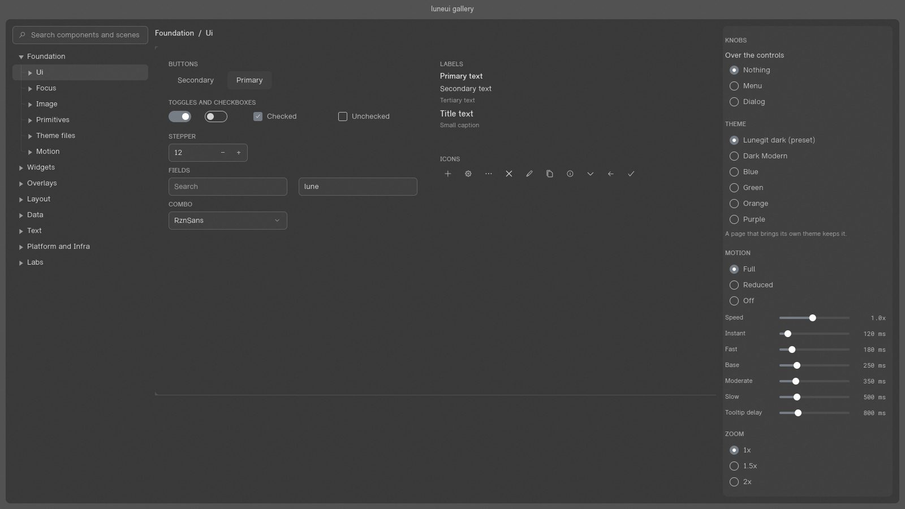
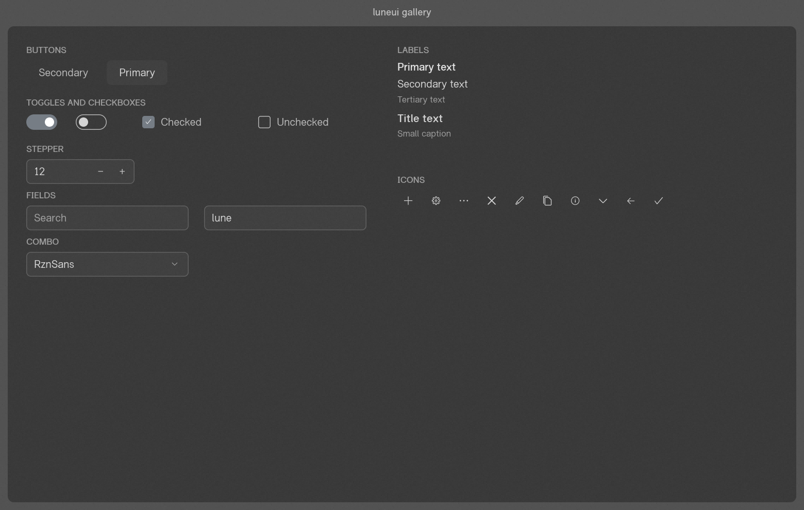
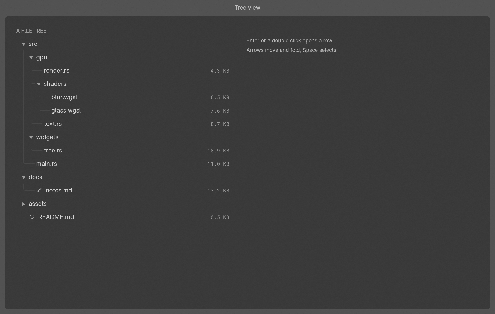
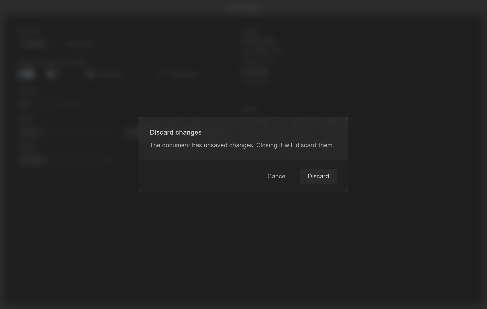
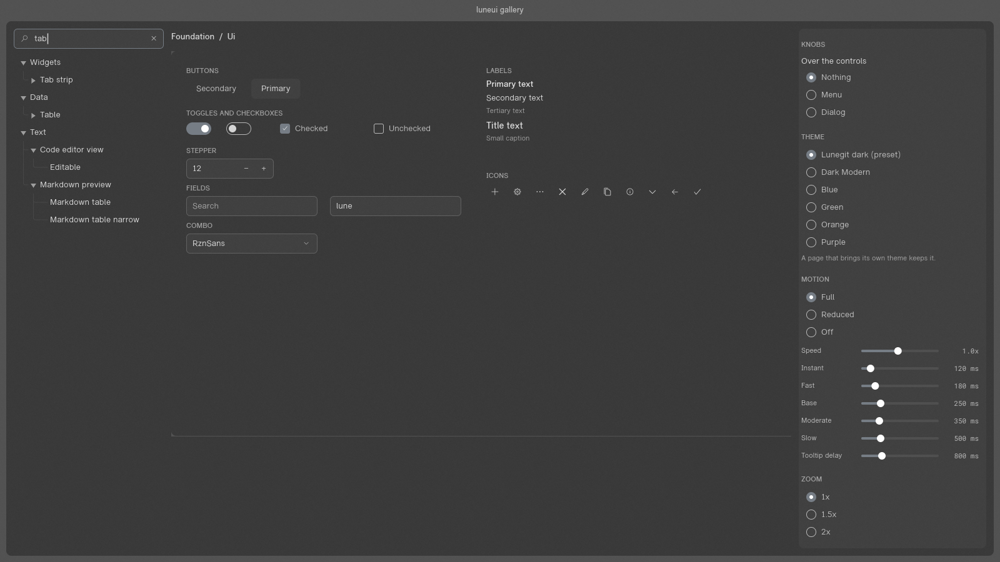
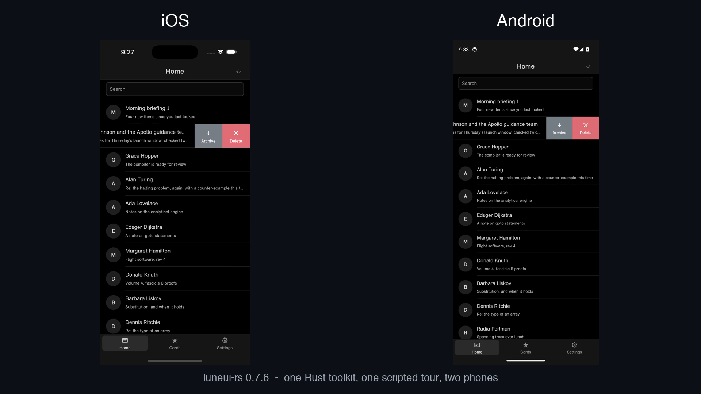

<p align="center">
  <a href="https://github.com/lune-rs">
    <picture>
      <source media="(prefers-color-scheme: dark)" srcset="https://raw.githubusercontent.com/lune-rs/.github/main/profile/assets/luneui-dark.svg">
      
    </picture>
  </a>
</p>

<p align="center">
  <a href="#-whats-in-it"><b>What's in it</b></a> ·
  <a href="#-phones"><b>Phones</b></a> ·
  <a href="#-try-it"><b>Try it</b></a> ·
  <a href="#-crates"><b>Crates</b></a> ·
  <a href="#-using-it-in-an-app"><b>Using it</b></a> ·
  <a href="#-developing"><b>Developing</b></a>
</p>

<p align="center">
  
  
  
  
  
</p>

**luneui-rs** is a native Rust UI toolkit for glass-style apps on the desktop and on phones: an
immediate-mode painter on [wgpu](https://wgpu.rs), over 110 catalogued components, OS glass
materials, touch and gestures, window helpers and theme tokens. **No web engine and no CSS**:
styles are Rust values.

<p align="center">
  
</p>

It was extracted from the Luneterm terminal's UI layer so several Rust apps can share it. Its look
follows Lunegit, a desktop git client. The toolkit itself is app-agnostic: no app or domain words
appear in library code, and a script enforces that.

**Status:** in development, not on crates.io (`publish = false`). The API still changes; additive
releases are patches, and `docs/consuming.md` lists every change in its migration maps.

## 🧩 What's in it

- 🎨 **A painter and a display list.** Rounded fills, strokes, paths, text, images and glass,
  recorded into a `Scene` and drawn by wgpu. Frames are deterministic: the app passes in time,
  sizes, fonts and theme, and the toolkit never reads the clock or the environment.
- 🧱 **Widgets.** Buttons, fields, text areas, a code editor, markdown, a diff view, tables, a tree
  view, tab strips, menus, dialogs, popovers, tooltips, toasts, a command palette, a lane graph and
  more. All of them have keyboard focus, disabled states, motion tiers (full, reduced, off) and an
  accessibility tree, bridged to AccessKit by an optional feature.
- 🪟 **Glass.** Every in-window glass surface frosts the app content behind it, stacked: a dialog
  frosts the page, a list in the dialog frosts the dialog. On the desktop the window's own
  background can use the OS material (macOS vibrancy, Windows acrylic or Mica).
- 🌗 **Themes.** One `Theme` value colours everything. Load one from JSON, or use the built-in dark
  preset.
- 🖥️ **Platform pieces.** Window helpers (caption buttons, edges), a tray item and its popover
  window, and clipboard requests.
- 👆 **Touch.** Taps, long presses, pans with scroll physics, pinch, 44 pt touch targets, touch text
  editing with handles, safe-area and keyboard insets.

<table>
  <tr>
    <td width="50%"><br><sub><b>Controls</b>: buttons, toggles, fields, steppers</sub></td>
    <td width="50%"><br><sub><b>Tree view</b>: keyboard focus and states built in</sub></td>
  </tr>
  <tr>
    <td width="50%"><br><sub><b>Dialogs</b>: stacked glass frosts what is behind it</sub></td>
    <td width="50%"><br><sub><b>Search</b>: the command palette and filtering</sub></td>
  </tr>
</table>

These images are the gallery's own scene renders: the headless dumps its pixel gate compares.

## 📱 Phones

The same toolkit runs on iOS and Android. `apps/demo` is a three-tab phone app built only from
public components, and it plays a scripted tour of them by itself.

<p align="center">
  <a href="docs/images/mobile-demo.mp4">
    
  </a>
  <br><sub>The same scripted tour on iOS (left) and Android (right). Click for the 46 s video.</sub>
</p>

- **Mobile components:** navigation bar, bottom tab bar, bottom sheet, navigation stack with edge-swipe
  back, pager, swipe row actions and pull to refresh, each with a mouse or keyboard path too.
- **Platform layer:** the safe area, the on-screen keyboard inset and the clipboard on both phones;
  the app owns suspend and resume.
- **Where it has run:** the iOS Simulator (`scripts/ios-sim.sh`) and an Android emulator
  (`scripts/android-emu.sh`), where the demo tour passes all 16 checked marks. Both scripts create
  their own device. **Not yet verified:** a real device, a real finger, VoiceOver or TalkBack.
- **Glass on a phone** is the toolkit's own frost over the app's content; the OS wallpaper is not
  part of it.

`docs/mobile.md` has the readings, `docs/demo-mode.md` how to run and record the tour, and
`docs/consuming.md` what a phone app adds.

## 🚀 Try it

```bash
cargo run -p gallery          # the showcase window: every page live, with knobs and settings
cargo run -p starter          # the smallest app on the toolkit (apps/starter/src/screen.rs)
cargo run -p demo -- --demo --touches   # the phone app, playing its tour on the desktop
```

In the gallery, Cmd or Ctrl `]` and `[` walk the pages; Cmd or Ctrl `Q` quits.
`cargo run -p gallery -- --list` prints the scene names, and `-- --dump <dir>` renders them all to
PNG without a window.

The pinned toolchain is Rust 1.92.0 (`rust-toolchain.toml`); the minimum is 1.85, edition 2024. Day to
day it runs on macOS. CI builds and tests on macOS, Linux and Windows, but the Windows and Linux
windows have had less use, and Linux has no tray.

## 📦 Crates

| crate | what it holds | depends on |
|---|---|---|
| `lune-ui-core` | painter, scene, widgets, theme, text editing, gestures, the seam types and their fakes | nothing (no wgpu, winit or cosmic-text types) |
| `lune-ui-wgpu` | GPU device, frame renderer, window surfaces, blur and glass, text rendering with its own glyph rasterizer | core, wgpu, cosmic-text, swash |
| `lune-ui-winit` | window attributes, input translation (mouse, keys, touch), output | core, winit |
| `lune-ui-platform` | OS glass materials, tray item, popover window, the iOS and Android layer (the only `unsafe` code) | core, OS crates |
| `lune-ui` | the facade: one `lune_ui::<module>` path for everything | the four above |

An adapter never depends on another adapter. Each seam (text, images, input and output, glass
backdrop) has a fake and a contract test in `lune_ui_core::testing`, so you can test a widget
without a GPU.

## 🔌 Using it in an app

There is no composition root: the app owns the event loop, creates the windows and wires the
adapters. Each frame it passes in `RawInput` (time, pointer, touch, keys, size, scale), calls
widgets on a `Ui`, and acts on the `FrameOutput` (window commands, cursor, clipboard, repaint,
accessibility). `apps/gallery` is the worked example for the desktop and `apps/demo` for a phone.

Depend on the facade by git:

```toml
[dependencies]
lune-ui = { git = "https://github.com/lune-rs/luneui-rs" }   # optional feature: accesskit
```

or vendor a snapshot (`scripts/export-snapshot.sh`). `docs/consuming.md` covers both, along with
the app's duties and the release size.

## 🛠️ Developing

```bash
cargo build --workspace
cargo test --workspace                                  # GPU tests skip without an adapter
cargo clippy --workspace --all-targets -- -D warnings
cargo fmt --all
scripts/check-boundaries.sh                             # app-agnostic, no clock or env, unsafe placement
scripts/gen-component-index.sh                          # regenerate docs/components/INDEX.md
scripts/gen-decisions-index.sh                          # regenerate docs/DECISIONS-INDEX.md (--check in the gate)
scripts/new-component.sh widget my-chip                 # scaffold a component (docs/components/adding.md)
scripts/check-component.sh widget.my-chip               # check it against the checklist (--all: every done entry)
scripts/pixel-gate.sh                                   # render every scene before and after, compare
scripts/check-targets.sh                                # clippy for Windows, macOS, iOS, Android; Linux in Docker
```

`CLAUDE.md` has the full gate line run before every commit, and the rules behind it.

<details>
<summary><b>🤖 For LLMs and coding agents</b></summary>

Read these in this order, and only as far as the task needs:

1. `CLAUDE.md` (`AGENTS.md` points to it): commands, the gate, architecture rules, and the hard rules
   that the boundary script and lints enforce.
2. `docs/STATE.md`: what is being worked on now, what's next, and the known limits.
3. `docs/DECISIONS-INDEX.md`, then `docs/DECISIONS.md`: every decision with its reason and what was
   rejected. Don't re-open one unless the user asks.
4. `docs/architecture.md`: the module map, seams, draw order, multi-window model and pixel gates.
5. `docs/components/INDEX.md` (generated): every component, with one file each under
   `docs/components/<area>/<id>.md` giving its API, look values with their sources, states, tests
   and what is unverified.
6. `docs/consuming.md`: how an app takes the toolkit in, plus the migration maps of API changes.
7. `apps/starter/src/screen.rs`: the smallest app on the toolkit, a 60-line screen to copy;
   `docs/design-recipes.md` and `docs/screen-review.md` then say how to build and judge a bigger one.

Rules that catch newcomers:

- Library code never reads the clock or the environment and never starts an event loop.
- A widget takes every colour from `ui.theme()`, never a literal.
- `unsafe` is allowed only in `lune-ui-platform` under `src/platform/` or `src/material/`.
- A change to a component's drawing passes the pixel gate. An intended look change names its scenes
  with `--allow` and adds a DECISIONS row.
- New behaviour goes in a new module or a `Theme` value, not in a patch to an app-specific path.

</details>

## 📄 Licence

Licensed under either of [MIT](LICENSE-MIT) or [Apache-2.0](LICENSE-APACHE), at your option.
Bundled third-party assets (fonts, the acrylic noise texture, Avalonia's colour formulas) keep their
own licences; see `THIRD_PARTY_NOTICES.md` and `licenses/`.
